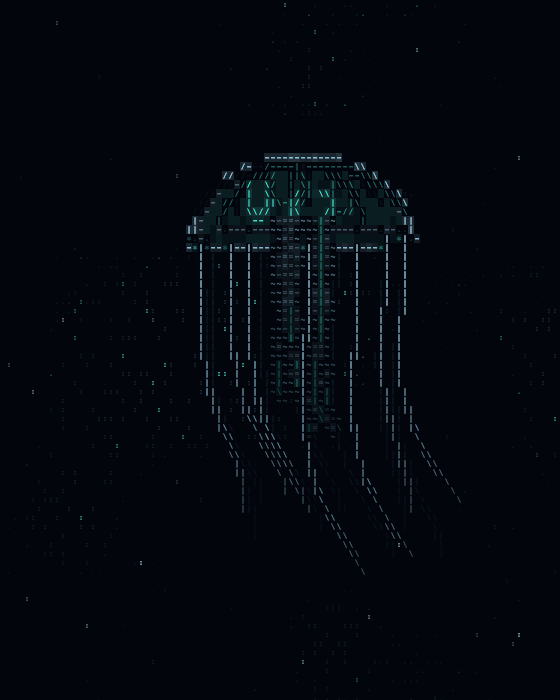
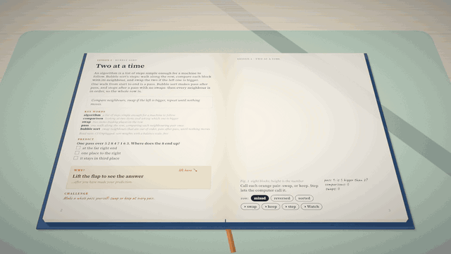

# skills

Agent skills for Claude Code, Codex, Cursor and any other agent that reads `SKILL.md`. Each one packages a workflow I've used for real work, with scripts that check the result.

[](https://github.com/mys1erious/skills/actions/workflows/validate.yml) [](LICENSE)



```bash
npx skills add mys1erious/skills
```

## Skills

| Skill | What it does | Install one |
|---|---|---|
| [ascii-art](skills/ascii-art) | Builds ASCII art that looks designed: animated and interactive canvas pieces, image, logo and text to ASCII, plain-text art, and loopable videos for X. Tests what it builds in headless Chrome. | `npx skills add mys1erious/skills --skill ascii-art` |
| [interactive-book](skills/interactive-book) | Builds an interactive 3D book that teaches any topic, one lesson per spread: predict, lift the flap, play with an ink-drawn figure, meet the challenge. Tests it in headless Chrome, publishes it to GitHub Pages and records a captioned video for X. | `npx skills add mys1erious/skills --skill interactive-book` |

## ascii-art

The GIF above came from one prompt to a fresh agent that had only this skill:

> make me an interactive ASCII animation of a jellyfish drifting through the deep sea — something I can post on X and that people can also play with in the browser

It built:
- a page where the jellyfish swims toward your cursor, and holding and releasing makes it gather light and strike;
- a seamless 12-second 4:5 video for X.

It also checked its own work in headless Chrome. Six rounds of screenshots caught five visual faults, and it fixed them before reporting. What it found hard went back into the skill.

**Ask it for things like:**
- "Turn our logo into an ASCII hero background that reacts to the mouse."
- "Render this photo as ASCII and give me the plain text for the README."
- "Make a 12-second loop of an ASCII eye opening, with 3 styles to compare."
- "Make the login page background an ASCII field in our brand colours."
- "Export that piece as a 4:5 MP4 for X."

**What's inside:**
- **A workflow** in `SKILL.md`: brief, source, composition rules, interaction, the conventions every piece keeps, how to check it, export.
- **A starter piece** (`assets/starter.html`): one HTML file with no dependencies. It has a cell-buffer renderer, style presets, a fixed-step timeline that loops seamlessly, `?t=` stills, `?hold` to play with one moment, `?clean` capture mode, `R` to record and `T` for plain text.
- **`scripts/shoot.mjs`:**
  - headless screenshots at timeline moments;
  - scripted mouse and keyboard actions to test interaction;
  - contact sheets;
  - page-error checks.
- **`scripts/render.mjs`:** renders frame by frame on a virtual clock, so the video is perfectly smooth. It then makes an MP4 with ffmpeg and reports whether the loop's seam shows.
- **References** the agent reads when it needs them:
  - `rendering.md`: the engine;
  - `recipes.md`: fire, lightning, rain, flocks, warps, image and text to ASCII;
  - `interaction.md`: follow, gaze, hold-and-release, gestures;
  - `video.md`: sizes for X, sound, editing.

**Requirements:** a modern browser. The scripts need Node 22+ and Chrome, Chromium or Edge; MP4 export also needs ffmpeg. No npm packages.

**What it sends where:** nothing leaves your machine. The pieces it builds load no external resources. The scripts start a local headless browser with a temporary profile, then delete the profile.

## interactive-book



The clip above came from one prompt to a fresh agent that had only this skill:

> make me an interactive 3D book that teaches how sorting algorithms work, for complete beginners. 3 lessons is enough for now. I want to share it with people and post a short video of it on X

It built:
- a book in three lessons: bubble sort, selection sort and merge sort. Eight numbered blocks run through all three, and the margin counts comparisons so the methods can be compared;
- a 40-second 1920×1080 video for X, cut from the lessons' captioned camera tours.

It checked its own work with 13 model tests and 14 browser tests, and by looking at screenshots of every spread and every camera shot. The screenshots caught what the tests didn't:
- a row of blocks that rose off the top of the page;
- tour shots that cropped their subject;
- two blocks that passed through each other mid-move.

Its 11 notes on the skill went back into it, among them a tap bug in the template, a rule for how far back tall things can stand, and the space budget at the bottom of a page.

**Ask it for things like:**
- "Make a 3D book that teaches how vaccines train the immune system, for 12-year-olds."
- "Turn my /teach lessons on SQL joins into an interactive book."
- "Add a lesson on quicksort to the book, same style as the others."
- "Record a 30-second video of lessons 2 and 5 for X."
- "Publish the book on GitHub Pages."

**What's inside:**
- **A workflow** in `SKILL.md`:
  1. the brief and the outline, approved before building;
  2. research and sources;
  3. one lesson at a time;
  4. composition rules for the 3D figure;
  5. checking by tests and by looking;
  6. publishing;
  7. the video.
- **A template book** (`assets/template/`): Vite and three.js, with one example lesson (a seesaw). It has:
  - window light, soft shadows and a hatched ink material;
  - page turns;
  - printed switches and buttons, and things to tap in 3D;
  - the flap, the challenge stamp and the Watch tour;
  - a text version that passes axe.
- **Tests:** model tests in node. Browser tests that open every spread, sweep every control, lint the content, run the tour, fuzz random clicks and keys, and check the text version with axe.
- **Scripts:**
  - `shoot.mjs`: screenshots of every spread, every camera shot and mid-move frames, with contact sheets;
  - `record.mjs`: a frame-exact video on a paused clock;
  - `deploy-pages.sh`: GitHub Pages, writing only the `gh-pages` branch;
  - `artifact-page.mjs`: a claude.ai Artifact.
- **References** the agent reads when it needs them:
  - `lessons.md`: every field and the rules the tests enforce;
  - `scenes.md`: the scene contract, the kit and camera shots;
  - `look.md`: the renderer and the review method;
  - `video.md`: recording, cutting and the post.

**Requirements:** Node 22+ and npm. The first install fetches three.js, Vite, Playwright and Playwright's Chromium. MP4 export needs ffmpeg, and publishing needs the gh CLI. Headless WebGL is fast on macOS (Metal) and slow on Linux (software rendering).

**What it sends where:** building and testing run locally. npm downloads packages from the npm registry. The book itself loads nothing from other sites: its fonts are bundled. Publishing pushes the built book to the GitHub repo you name.

The look follows [Every Joule](https://github.com/iamtechartist/every-joule-lesson1) by [@techartist_](https://x.com/techartist_). The template is our own code; none of Every Joule's is used.

## Install

<details>
<summary><b>Any agent, with the skills CLI</b></summary>

```bash
npx skills add mys1erious/skills                                   # choose skills and agents
npx skills add mys1erious/skills --list                            # see what's here
npx skills add mys1erious/skills --skill ascii-art -a claude-code -g -y
npx skills add mys1erious/skills --skill interactive-book -a claude-code -g -y
```

Run `npx skills update` to update.
</details>

<details>
<summary><b>Claude Code plugin</b></summary>

```
/plugin marketplace add mys1erious/skills
/plugin install ascii-art@mys1erious
/plugin install interactive-book@mys1erious
```

Run `/plugin marketplace update mys1erious` to update.
</details>

<details>
<summary><b>Manual copy</b></summary>

Copy a skill's folder, such as `skills/ascii-art/`, into your agent's skills folder:

| Agent | Your user | One project |
|---|---|---|
| Claude Code | `~/.claude/skills/` | `.claude/skills/` |
| Codex | `~/.agents/skills/` | `.agents/skills/` |
| Cursor | `~/.cursor/skills/` | `.cursor/skills/` |

</details>

## Checks

Every pull request:
- validates each skill against the [Agent Skills spec](https://agentskills.io/specification);
- validates the Claude Code marketplace;
- renders the ascii-art starter in headless Chrome, and fails on any page error;
- builds the interactive-book template, runs its model tests, and opens every spread in headless Chromium, failing on any page error or text that runs off a page.

## License

[MIT](LICENSE)
