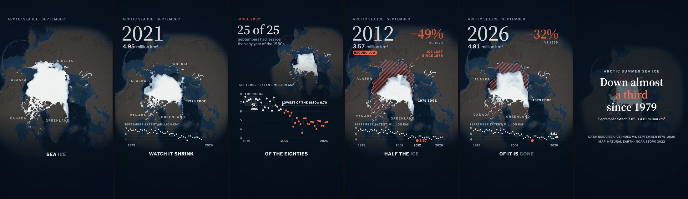

# skills

Agent skills for Claude Code, Codex, Cursor and any other agent that reads `SKILL.md`. Each one packages a workflow I've used for real work, with scripts that check the result.

[](https://github.com/mys1erious/skills/actions/workflows/validate.yml) [](LICENSE)


```bash
npx skills add mys1erious/skills
```

## Skills

| Skill | What it does | Install one |
|---|---|---|
| [ascii-art](skills/ascii-art) | Builds ASCII art that looks designed: animated and interactive canvas pieces, image, logo and text to ASCII, plain-text art, and loopable videos for X. Tests what it builds in headless Chrome. | `npx skills add mys1erious/skills --skill ascii-art` |
| [explainer-video](skills/explainer-video) | Makes short narrated explainer videos drawn in code, where the picture shows what the voice teaches with real data. Script, AI voice with word timings, frame-exact render, music and sound mix, and several styles to compare. | `npx skills add mys1erious/skills --skill explainer-video` |

## ascii-art

The GIF above came from one prompt to a fresh agent that had only this skill:

> make me an interactive ASCII animation of a jellyfish drifting through the deep sea — something I can post on X and that people can also play with in the browser

It built:
- a page where the jellyfish swims toward your cursor, and holding and releasing makes it gather light and strike;
- a seamless 12-second 4:5 video for X.

It also checked its own work in headless Chrome. Six rounds of screenshots caught five visual faults, and it fixed them before reporting. What it found hard went back into the skill.

**Ask it for things like:**
- "Turn our logo into an ASCII hero background that reacts to the mouse."
- "Render this photo as ASCII and give me the plain text for the README."
- "Make a 12-second loop of an ASCII eye opening, with 3 styles to compare."
- "Make the login page background an ASCII field in our brand colours."
- "Export that piece as a 4:5 MP4 for X."

**What's inside:**
- **A workflow** in `SKILL.md`: brief, source, composition rules, interaction, the conventions every piece keeps, how to check it, export.
- **A starter piece** (`assets/starter.html`): one HTML file with no dependencies. It has a cell-buffer renderer, style presets, a fixed-step timeline that loops seamlessly, `?t=` stills, `?hold` to play with one moment, `?clean` capture mode, `R` to record and `T` for plain text.
- **`scripts/shoot.mjs`:**
  - headless screenshots at timeline moments;
  - scripted mouse and keyboard actions to test interaction;
  - contact sheets;
  - page-error checks.
- **`scripts/render.mjs`:** renders frame by frame on a virtual clock, so the video is perfectly smooth. It then makes an MP4 with ffmpeg and reports whether the loop's seam shows.
- **References** the agent reads when it needs them:
  - `rendering.md`: the engine;
  - `recipes.md`: fire, lightning, rain, flocks, warps, image and text to ASCII;
  - `interaction.md`: follow, gaze, hold-and-release, gestures;
  - `video.md`: sizes for X, sound, editing.

**Requirements:** a modern browser. The scripts need Node 22+ and Chrome, Chromium or Edge; MP4 export also needs ffmpeg. No npm packages.

**What it sends where:** nothing leaves your machine. The pieces it builds load no external resources. The scripts start a local headless browser with a temporary profile, then delete the profile.

## explainer-video

A 30-second video that teaches one idea and shows the evidence: the voice says "nine in ten quakes hit near a plate edge", and 8,558 real 2025 earthquakes light up along the real plate boundaries. The agent writes the script and fetches the data. It then draws every frame in code, so each number, date and label on screen comes from the data, and it renders the video frame by frame.



The frames above came from one prompt to a fresh agent that had only this skill:

> make me a 30 second TikTok that teaches how much Arctic sea ice we've lost since satellites started measuring it — with the real numbers and the actual data on screen. It should look high-end, like a top data-journalism piece, not a simple template animation.

It:
- pulled 48 Septembers of NSIDC satellite ice maps and the extent series;
- computed every spoken number from that data and asserted it in a prep script;
- generated two target frames for the look and built the page to match them;
- checked contact sheets and frames before rendering the 28-second video with voice, music and sound.

What it found missing went back into the skill.

**Ask it for things like:**
- "Make a 30-second TikTok that shows how earthquakes reveal the tectonic plates, with real USGS data."
- "Explain compound interest in 40 seconds, with the numbers on screen."
- "Turn this CSV into a narrated data story for Reels."
- "Make the same video in 4 styles so I can pick one."

**What's inside:**
- **A workflow** in `SKILL.md`: brief, script, data, voice, page, checking by looking, render, and the pitfalls behind each step.
- **An engine** (`assets/engine.js`): every frame is a function of time. It has motion blur, grain, springs, a camera, captions and word-by-word subtitles.
- **A starter** (`assets/starter/`): a 12-second video with real data to copy.
- **`scripts/voice.py`:** narration to voice and word timeline with ElevenLabs, voice design, and silent drafts without a key.
- **`scripts/render.py`:** contact sheets, frames and the video, made frame by frame in headless Chrome.
- **`scripts/audio.py`:** synthesized music and sound effects on the cue words, mastered to -14 LUFS and muxed.
- **`scripts/targets.py`:** target frames from Gemini, so each style is built to match a picture.
- **References:**
  - `engine.md`: the API, sounds and performance;
  - `data.md`: sources and the truth rules for what goes on screen;
  - `styles.md`: several styles built in parallel and compared.

**Requirements:** Python 3.10+ with [uv](https://docs.astral.sh/uv/) (or pip), ffmpeg, and Google Chrome or Playwright's Chromium. The voice needs an ElevenLabs API key, and style targets a Gemini key. Without them it still makes silent drafts.

**What it sends where:**
- **ElevenLabs:** the narration text, for the voice.
- **Gemini:** the scene and style descriptions, for target frames.
- **GitHub (google/fonts) and the data sources:** downloads only.

Keys are read from the environment or a `.env` file and are never printed. Rendering runs in a local headless browser.

## Install

<details>
<summary><b>Any agent, with the skills CLI</b></summary>

```bash
npx skills add mys1erious/skills                                   # choose skills and agents
npx skills add mys1erious/skills --list                            # see what's here
npx skills add mys1erious/skills --skill ascii-art -a claude-code -g -y
```

Run `npx skills update` to update.
</details>

<details>
<summary><b>Claude Code plugin</b></summary>

```
/plugin marketplace add mys1erious/skills
/plugin install ascii-art@mys1erious
```

Run `/plugin marketplace update mys1erious` to update.
</details>

<details>
<summary><b>Manual copy</b></summary>

Copy a skill's folder, e.g. `skills/ascii-art/`, into your agent's skills folder:

| Agent | Your user | One project |
|---|---|---|
| Claude Code | `~/.claude/skills/` | `.claude/skills/` |
| Codex | `~/.agents/skills/` | `.agents/skills/` |
| Cursor | `~/.cursor/skills/` | `.cursor/skills/` |

</details>

## Checks

Every pull request:
- validates each skill against the [Agent Skills spec](https://agentskills.io/specification);
- validates the Claude Code marketplace;
- renders the ascii-art starter and the explainer-video starter in headless Chrome, and fails on any page error.

## License

[MIT](LICENSE)
