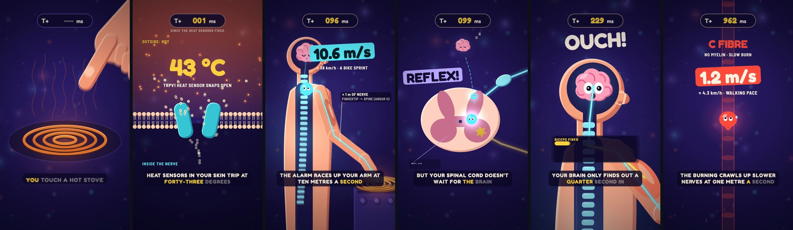

# explainer-video

Makes short narrated explainer videos drawn in code, where the picture shows what the voice teaches with real data. Script, AI voice with word timings, frame-exact render, music and sound mix, and several styles to compare.

A 30-second video that teaches one idea and shows the evidence: the voice says "nine in ten quakes hit near a plate edge", and 8,558 real 2025 earthquakes light up along the real plate boundaries. The agent writes the script and fetches the data. It then draws every frame in code, so each number, date and label on screen comes from the data, and it renders the video frame by frame.



The frames above came from one prompt to a fresh agent that had only this skill: "what happens in your body in the split second after you touch a hot stove, super dynamic, TikTok style". It made a 33-second ride from the fingertip through the nerve to the spinal cord and brain. A slow-motion millisecond clock runs throughout, the signals are characters that move at their measured speeds, and every number comes from published measurements.


Another fresh agent got a calmer brief:

> make me a 30 second TikTok that teaches how much Arctic sea ice we've lost since satellites started measuring it — with the real numbers and the actual data on screen. It should look high-end, like a top data-journalism piece, not a simple template animation.

It:
- pulled 48 Septembers of NSIDC satellite ice maps and the extent series;
- computed every spoken number from that data and asserted it in a prep script;
- generated two target frames for the look and built the page to match them;
- checked contact sheets and frames before rendering the 28-second video with voice, music and sound.

What both agents found missing went back into the skill.

## Ask it for things like

- "Make a 30-second TikTok that shows how earthquakes reveal the tectonic plates, with real USGS data."
- "Explain compound interest in 40 seconds, with the numbers on screen."
- "Turn this CSV into a narrated data story for Reels."
- "Make the same video in 4 styles so I can pick one."

## What's inside

- **A workflow** in [`SKILL.md`](SKILL.md): brief, script, data, voice, page, checking by looking, render, and the pitfalls behind each step.
- **An engine** ([`assets/engine.js`](assets/engine.js)): every frame is a function of time. It has:
  - motion blur, grain, springs and a camera;
  - shots with zoom-through and whip transitions;
  - kinetic type, shake, flash and glow;
  - callouts, captions and word-by-word subtitles.
- **A starter** ([`assets/starter/`](assets/starter)): a 12-second video with real data to copy.
- **[`scripts/voice.py`](scripts/voice.py):** narration to voice and word timeline with ElevenLabs, voice design, and silent drafts without a key.
- **[`scripts/render.py`](scripts/render.py):** contact sheets, frames and the video, made frame by frame in headless Chrome.
- **[`scripts/audio.py`](scripts/audio.py):** synthesized music and sound effects on the cue words, mastered to -14 LUFS and muxed.
- **[`scripts/targets.py`](scripts/targets.py):** target frames from Gemini, so each style is built to match a picture.
- **References:**
  - [`engine.md`](references/engine.md): the API, sounds and performance;
  - [`data.md`](references/data.md): sources and the truth rules for what goes on screen;
  - [`motion.md`](references/motion.md): TikTok pacing, with a new shot every second, impact and a character;
  - [`styles.md`](references/styles.md): several styles built in parallel and compared.

## Requirements

Python 3.10+ with [uv](https://docs.astral.sh/uv/) (or pip), ffmpeg, and Google Chrome or Playwright's Chromium. The voice needs an ElevenLabs API key, and style targets a Gemini key. Without them it still makes silent drafts.

## What it sends where

- **ElevenLabs:** the narration text, for the voice.
- **Gemini:** the scene and style descriptions, for target frames.
- **GitHub (google/fonts) and the data sources:** downloads only.

Keys are read from the environment or a `.env` file and are never printed. Rendering runs in a local headless browser.

## Install

```bash
npx skills add mys1erious/skills --skill explainer-video
```

Or in Claude Code: `/plugin marketplace add mys1erious/skills`, then `/plugin install explainer-video@mys1erious`. Other agents and manual copy: see [Install](../../README.md#install).
