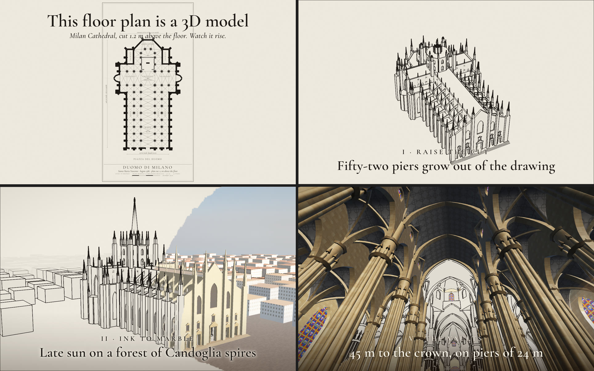

# plan-to-walk

Turns a floor plan into a scroll-driven 3D page where the plan is the 3D model itself. An ink plan sheet, a section cut that rises into walls, late sun sweeping the drawing into real stone, then a first-person walk through the rooms. A "your own plan" mode builds any typed room list.



The frames above came from one prompt to a fresh agent that had only this skill:

> Make a page for Milan Cathedral, the Duomo di Milano.

In about 45 minutes it built:
- the cathedral's plan as an ink sheet, cut 1.2 m above the floor;
- the 52 piers rising out of the drawing, then the sun sweeping it into marble;
- a walk in through the façade, down the nave, under the vaults and the tiburio to the apse, with a caption of sourced sizes at each stop.

It noted where its sources disagree and listed everything it approximated. The inside came out stronger than the outside: the façade is one flat colour, and it drew 110 of the 135 spires. What it found hard (constants tuned for a villa, indoor glare, sun flooding through glass, no screenshot tool) went back into the skill.

The original build is live: [Palladio's Villa La Rotonda](https://mys1erious.github.io/3d-plan-to-walk/).

## Ask it for things like

- "Turn this floor plan of our flat into a scroll page where the walls rise out of the drawing."
- "Make a plan-to-walk page for the Pantheon in Rome."
- "Here are the rooms and sizes of the house we're selling. Build the walkthrough."
- "Walk me through Villa Savoye, from the plan to the roof terrace."
- "Record that page as a 40-second 4:5 video for X."

## What's inside

- **A workflow** in [`SKILL.md`](SKILL.md): the typed route and the hero-building route, the typed plan format and its limits, how the engine works, the spec fields, scale settings for big buildings, beats that worked, checks and honesty rules.
- **A template** ([`assets/template/`](assets/template)): Villa La Rotonda as one HTML file (three.js, GSAP ScrollTrigger and Lenis, no build step). It has the section cut with ink caps, an ink-edge post pass, the drawing-to-stone sweep, procedural floors and frescoes, a typed-plan builder, `?t=` stills, `?play` and `?clean`. It comes with CC0 textures from Poly Haven and a README that shows how to source every size.
- **[`scripts/shoot.mjs`](scripts/shoot.mjs):** headless screenshots at timeline moments, contact sheets and page-error checks.
- **[`scripts/render.mjs`](scripts/render.mjs):** renders frame by frame on a virtual clock, so the video is perfectly smooth, then makes an MP4 with ffmpeg.

Idea credit: the format comes from [@SammmAing's Casa Serra post](https://x.com/SammmAing/status/2109708195031900310). None of their code was read or used.

## Requirements

A modern browser with WebGL, and a local static server for the textures (`python3 -m http.server`). The scripts need Node 22+ and Chrome, Chromium or Edge; MP4 export also needs ffmpeg. No npm packages.

## What it sends where

The pages load three.js, GSAP, Lenis and a font from jsDelivr and unpkg, at pinned versions. Nothing else leaves your machine. The scripts start a local headless browser with a temporary profile, then delete the profile.

## Install

```bash
npx skills add mys1erious/skills --skill plan-to-walk
```

Or in Claude Code: `/plugin marketplace add mys1erious/skills`, then `/plugin install plan-to-walk@mys1erious`. Other agents and manual copy: see [Install](../../README.md#install).
