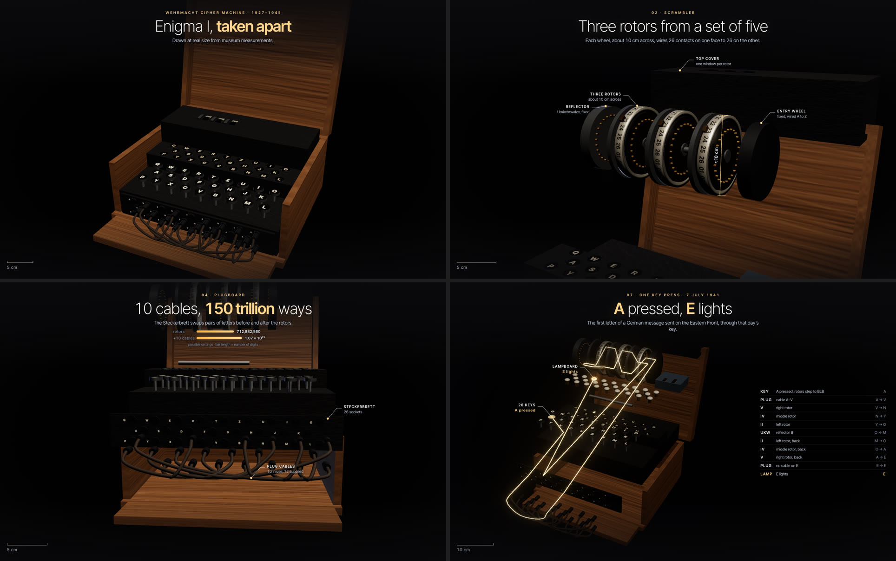

# take-apart

Builds a real object at real scale in three.js from sourced numbers, then takes it apart piece by piece on a self-playing timeline. It adds labels on leader lines, technical-drawing dimension lines, a scale bar and tap-for-details cards with source links. One HTML page that works on a phone and records to video.



The frames above came from one prompt to a fresh agent that had only this skill:

> Take apart an Enigma I cipher machine, the three-rotor Wehrmacht model.

In about 30 minutes it built a 38-second teardown in 9 chapters, with 14 parts you can tap:
- the case, the rotors and reflector, the stepping, the plugboard, the keyboard, the lamps and battery;
- a key press traced through the machine: A goes in through the plugboard, the three rotors and the reflector, and lamp E lights. It uses a real recovered daily key (7 July 1941), and the page checks its own cipher against a published test vector.

Every size on a card has a source; where no primary source gives a number, the card says it comes from a secondary one. What it found hard (Voyager-specific code it had to find, framing a wide object on a phone, near-plane clipping, no screenshot tool) went back into the skill.

The original build is live: [Voyager 1, taken apart](https://mys1erious.github.io/3d-voyager-teardown/).

## Ask it for things like

- "Take apart a Leica M6 and show what each part does."
- "Make an exploded view of the Apollo lunar module, with what each part did on the Moon."
- "What's inside a mechanical watch? Trace the power from the mainspring to the hands."
- "Build a teardown of our product from these CAD dimensions."
- "Record the teardown as a 4:5 video for X."

## What's inside

- **A workflow** in [`SKILL.md`](SKILL.md): research first, the data blocks to replace, how to build the model, the chapter recipe, checks and honesty rules.
- **A template** ([`assets/template/`](assets/template)): Voyager 1 as one HTML file (three.js, no build step, no image files). It has the explode timeline, a camera spline that frames at any aspect ratio, labels that switch to numbered chips on phones, dimension lines, a scale bar, tap cards with sources, a list chapter that dims everything and lights the parts in question, `?t=` stills, `?play` and `?clean`. Its README shows how to source every number.
- **[`scripts/shoot.mjs`](scripts/shoot.mjs):** headless screenshots at timeline moments, contact sheets and page-error checks.
- **[`scripts/render.mjs`](scripts/render.mjs):** renders frame by frame on a virtual clock, so the video is perfectly smooth, then makes an MP4 with ffmpeg.

## Requirements

A modern browser with WebGL. The scripts need Node 22+ and Chrome, Chromium or Edge; MP4 export also needs ffmpeg. No npm packages.

## What it sends where

The pages load three.js from jsDelivr at a pinned version. Nothing else leaves your machine. The scripts start a local headless browser with a temporary profile, then delete the profile.

## Install

```bash
npx skills add mys1erious/skills --skill take-apart
```

Or in Claude Code: `/plugin marketplace add mys1erious/skills`, then `/plugin install take-apart@mys1erious`. Other agents and manual copy: see [Install](../../README.md#install).
